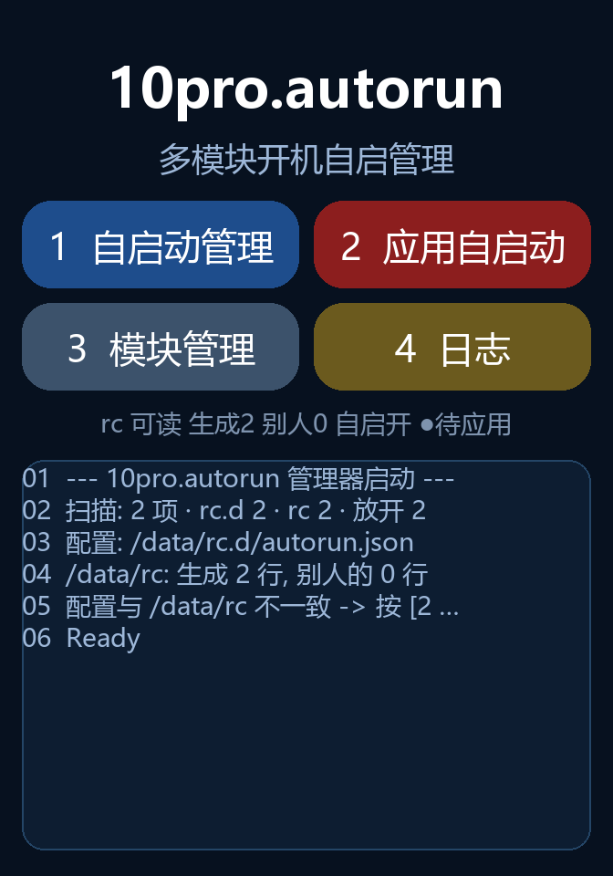

# MIBAND10PRO-AUTORUN

小米手环 10 Pro 原生模块开机自启动工程：一套管理器 + 三个原生模块（Shell++ II / Chaos / Canopus）的接入与安装器。

> **只是想用？** 直接看 **[`docs/USAGE.md`](docs/USAGE.md)** —— 简明安装与使用说明（Release 里的 `.bin` 怎么装、管理器里点哪两下、模块怎么挂上自启动）。
> 下面是给开发者/维护者的工程说明。



## 管理器能做什么

| 页 | 能力 |
|---|---|
| **主页** | 应用自启动（把配置写成 `/data/rc`）、模块管理、日志入口 |
| **自启动** | 装/卸开机钩子（写 flash 里那句 `sh /data/rc`）、总开关（防砖闸）、状态面板 |
| **模块管理** | 模块详情（状态/延迟/脚本大小/安装时间）、单模块开关、延迟调节（1–100 秒）、启动顺序（上移/下移/保存）、批量管理（全部启用/禁止，保存或放弃）、延迟管理（启动前/启动后两个窗口） |
| **日志** | 运行流水（三位序号）、清空 |

几个关键行为：

- **点一行 = 打开详情**，不是直接改开关；改完立刻落配置，但要按 `[应用]` 才写进 `/data/rc`。
- **`#top` 特权**：脚本第一行写 `#top`（也认 `# top` / `#tun`）的模块**掐在所有人前面跑**——闸一扣就上，不等窗口 1，彼此之间也不隔；只允许开关，不许调延迟/顺序。
- **两个窗口可调**：启动前延迟（默认 8 秒）、启动后延迟（默认 15 秒）。
- 顺序、批量、延迟三种模式都有「保存/放弃」两态，`[应用]` 只认**已保存**的配置。

## 支持设备

| 机型 | 固件 |
|---|---|
| 小米手环 10 Pro（`miwear.watch.p67tc`） | **3.101.043** |

## 项目框架

```
表盘安装器（Lua，Watchface/）
        │
        │  挂各模块自己的协议：
        │  Manager ── /data/rc.d 注册 + /data/rc 防砖闸
        │  chaos   ── chaos 协议（DQ + rc.d）
        │  canopus ── Canopus 协议（BOOT_DQ "3PC1" + rc.d）
        │  shellpp-ii ── /data/rc.d 注册
        ▼
原生模块（modules/，内核态 .ko / ELF）
        │  开机时由管理器生成的 /data/rc 逐条拉起
        ▼
固件（openvela / NuttX + LVGL）
```

各模块安装器只投"自己要跑什么"到 `/data/rc.d/<名>.sh`（纯命令），防砖闸与安全延时统一归管理器生成的 `/data/rc`，接入规范见 [`docs/MODULE-STANDARD.md`](docs/MODULE-STANDARD.md)、[`docs/REGISTER.md`](docs/REGISTER.md)。

管理器生成的那一段长这样（别人的行原样留在上面）：

```sh
echo gate_off >> /data/rc.d/.autorun.log   # 在 if 外面：闸关着也留痕
if [ -f /data/rc.d/.autorun.on ];then
rm -f /data/rc.d/.autorun.on               # 扣闸：跑不完就一直关着
sh /data/rc.d/boot.sh                      # #top 特权：立刻跑，不等待
sleep 8                                    # 窗口 1（可调）
sleep 1  /  sh /data/rc.d/chaos.sh         # 每个模块自己那一格延迟
sleep 3  /  sh /data/rc.d/shellpp2.sh
sleep 15                                   # 窗口 2（可调）
echo cleared >> /data/rc.d/.autorun.log    # 跑到底才写
echo on > /data/rc.d/.autorun.on           # 放行
fi
```

## 项目结构

```
MIBAND10PRO-AUTORUN/
├── Watchface/                  # 安装器表盘（可打包安装的完整 face 工程）
│   ├── module.autorun.Manager    # 管理器：自启动总闸 / 模块管理 / 日志
│   ├── module.autorun.shellpp-ii # Shell++ II 安装器
│   ├── module.autorun.chaos      # Chaos 安装器（chaos 协议）
│   └── module.autorun.canopus    # Canopus 安装器（Canopus 协议）
│
├── modules/                    # 模块源码
│   ├── Shellpp-ii               # Shell++ II（安装器，Apache-2.0）
│   ├── Chaos-Module             # Chaos 模块本体（完整源码，AGPL-3.0）
│   └── Canopus-Module           # Canopus 模块框架（完整源码，AGPL-3.0）
│
├── docs/                       # 文档（使用教程、接入标准、注册契约、设计记录）
├── tool/                       # 构建 / 门禁 / 离线渲染
└── other/                      # 备份与留档（基本无用）
```

## 如何开发

### 改管理器（Lua）

真源是 **`Watchface/module.autorun.Manager/resources/_lua/_Lua/module-autorun-manager.lua`**（打包、渲染都用它）。同包的 `_Lua/module-autorun-manager.lua` 是编辑副本，**正文与之逐字一致，只差文件头那 94 行注释**——改完记得同步。

```bash
# 语法门（没有 lua CLI 就用 lupa）
python -c "import lupa;print(lupa.LuaRuntime().eval('function(s) return load(s)~=nil end')(open(r'Watchface/module.autorun.Manager/resources/_lua/_Lua/module-autorun-manager.lua',encoding='utf-8').read()))"
```

### 打包表盘（.face）

```bash
python tool/build_face.py                      # 产物在 _build/manager/output/
python tool/build_face.py --preview 封面.png    # 换预览图（任意尺寸，自动缩到 336x480）
python tool/build_face.py --desk 名字.face      # 顺带复制到桌面
```

需要 `C:\Program Files (x86)\Mi Create\compiler\compile.exe`（或 `C:\face_tools\compiler\compile.exe`）。脚本自带 12 项判据：Lua 语法门、预览图尺寸、容器魔数、显示名、**容器里的 lua 与源逐字节相同**。

### 三道门（Chaos 侧）

```bash
python tool/check_all.py     # G1 ko 编译门 / G2 搬移块逐字节 / G3 安装器行为门
```

### 离线渲染（不用真机看 UI）

```bash
python tool/render_manager_ui.py --seed --scale 2 --out docs/img
```

用假 lvgl 跑真源，把四页画成 PNG。它同时也是**行为门**——假环境会故意比真机严：
给 lv_obj 挂字段、或用了平台没先例的 `ALIGN` 常量，都会当场报错。

## 三条硬约束（踩过的坑）

1. **主 chunk 的 `local` 只有个位数余量**（Lua 上限 200）。新东西先塞表（`UI` / `FM` / `LOGBUF` 那样）。
2. **`lv_obj` 是 userdata，不能挂自定义字段**。要存子控件引用就开侧表（`UI.lbl[按钮] = label`）。
3. **对齐常量只用 `CENTER` / `TOP_LEFT` / `TOP_MID`**——这三个在本平台有先例，其它（如 `BOTTOM_MID`）真机上是 nil。

## 许可

| 范围 | 许可 |
|---|---|
| 仓根（管理器、文档、脚本） | [Apache-2.0](LICENSE) |
| `modules/Shellpp-ii` | Apache-2.0 |
| `modules/Chaos-Module` | AGPL-3.0 |
| `modules/Canopus-Module` | AGPL-3.0 |

各目录许可以其自身 `LICENSE` 为准，完整说明见 [`docs/NOTICE.md`](docs/NOTICE.md)。
